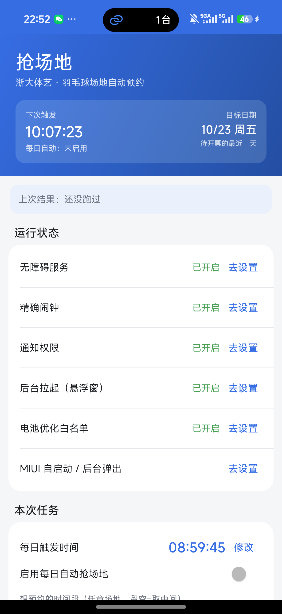
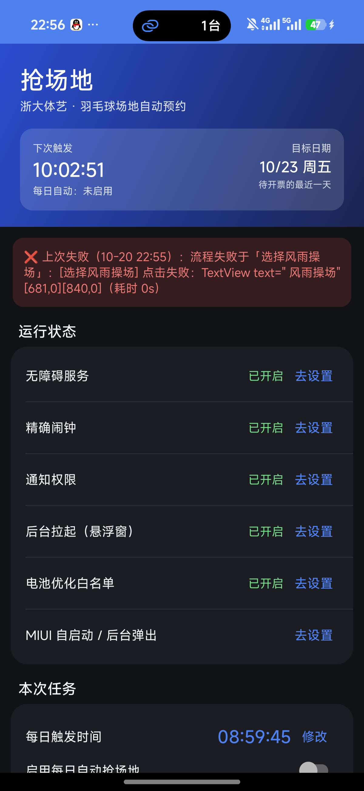

# 抢场地 · 浙大体艺羽毛球场地自动预约

<sub>项目代号：**π = 3.14** · 仓库：<https://github.com/Wyc330/ZJU-Badminton> · 协议：[MIT](LICENSE)</sub>

📦 **下载 APK**：[最新 Release](https://github.com/Wyc330/ZJU-Badminton/releases/latest) · 版本 **0.9.0alpha36** · `versionCode 36`

Android 原生 App（Kotlin + 无障碍服务），在「浙大体艺」里自动完成羽毛球场地预约：
**每天 09:00 放号瞬间抢「待开票的最近一天」**，全程无人值守，抢到后弹出明确结果提示。

---

## 一、能做什么

| 能力 | 说明 |
|---|---|
| **双引擎预约** | ① 直连模式：直接调用场馆系统接口（放号瞬间 0.2~0.6s）② 界面自动化：真实点击 H5（失败自动回退，兜底） |
| **提交后全链路** | 验证码接力（人工点选→自动继续）→ 自动「支付 ¥0」→ 等「预约成功」→ 解析订单号/时段/场地并通知 |
| **步骤看门狗** | 每一步硬超时，卡住就判失败并记下最后界面文字，不再「静默卡死」 |
| **放号前提醒** | 每天触发时间前 12 分钟（默认 08:47）发高优先级通知：目标日期 / 登录态剩余 / 同伴码是否已填 / 直连开关 |
| **登录态管理** | 内置场馆系统登录页；JWT 只有 4 小时有效期，快过期时自动「静默续期」（CAS 会话还在就免密续上），失败通知你手动登录 |
| **失败诊断** | 失败后主界面直接给「人话结论 + 一键处理」：登录失效→去登录、同伴码失效→去填写、没抢到→再试一次、页面空白→重试… |
| **结果持久化** | 成功/失败/日期/时段/耗时落盘，重启 App 仍能看到上次结果 |
| **学习式操作** | 第一次跑到控件时记住坐标，之后直接按坐标点，跳过遍历节点树（每次省 50~150ms） |
| **时段表识别** | 时段表是纯色块无文字：绿=空闲 / 红=已预约 / 灰=不开放 / 黄=未支付 / 浅蓝=已选择，用 `takeScreenshot()` 截图取色判断 |
| **深色模式** | 全套深色配色 + 自适应图标 + Android 12 启动画面，跟随系统 |

## 二、快速开始（5 步）

1. **安装** APK，打开 App。
2. **打开 5 项权限**（主界面每项都有「去开启」）：无障碍服务、精确闹钟、通知、悬浮窗（后台拉起）、电池白名单。
3. **登录场馆系统**：点「登录场馆系统」→ 在页面里输入一次学号密码（只在你手机上输入；App 不记录、不上传）。
4. **填同伴码**：让同伴在「场馆管理 → 同伴管理 → 我的同伴码」生成 5 位码发你，填进「同伴码」输入框；
   预约时这个码会一起提交（**一次性，用后作废**）。
5. **打开「启用每日自动抢场地」**，建议先保持「演练模式」点一次「立即试跑一次」确认界面流程没问题。

到点后：直连模式先调接口下单；任何原因失败会自动回退到界面自动化，结束后弹结果框 + 通知 + 震动。

## 三、放号规则（决定抢哪天）

- 每天 **09:00** 放「后天」的号。
- 目标日期 = **待开票的最近一天**：
  - 09:00 前触发 → **今天 + 2**
  - 09:00 后触发 → **明天 + 2**
- 页面上的日期窗口实测只有「今天 / 明天 / 后天」可选，周末不特殊处理。

## 四、界面

| 浅色 | 深色 |
|---|---|
|  |  |

## 五、配置文件（免重装热更新）

路径：`/sdcard/Android/data/com.zju.courtgrab/files/config/grab-config.json`
（点主界面「导出默认配置到下载目录」可拿到完整模板；改完点「重新载入配置文件」即生效）

最常改的键：

| 键 | 作用 |
|---|---|
| `releaseHour` / `releaseMinute` | 放号时刻（默认 9:00） |
| `dateCfg.useNextReleaseDate` / `dateCfg.releaseDaysAhead` | 目标日期策略（默认「待开票最近一天」，放号日 + 2 天） |
| `preferredSlotStart` | 想约的时段开始时间（如 `"18:30"`），留空=取中间 |
| `directVenueName` / `directVenueSiteId` | 直连模式匹配的场馆（默认「风雨操场」） |
| `directMaxWaitMs` / `directPollMinMs` / `directPollJitterMs` / `directMaxAttempts` | 直连轮询节奏（默认 120s 窗口、250~650ms 抖动、最多 240 轮） |
| `autoPay` | 提交后是否自动点「支付」（¥0 也必须点，否则 3 分钟内自动取消；默认 true） |
| `captchaWaitMs` / `payWaitMs` | 等人工完成验证码 / 等「预约成功」页的最长时间（默认 120s / 25s） |
| `stepWatchdogMs` | 单步看门狗超时（默认 90s） |
| `noticeTexts` / `noticeCloseXRatio` / `noticeCloseYRatio` | 预约须知弹窗识别词与关闭按钮相对坐标 |
| `venueFengYu` / `venueBadminton` / `btnBookNow` 等 Locator | 界面自动化定位器（文案/正则/焦点） |
| `slotGridCfg.*Colors` | 时段表颜色阈值（若学校改了配色，改这里即可） |

完整字段见 [docs/grab-config.sample.json](docs/grab-config.sample.json)。

## 六、常见问题

| 现象 | 原因 / 处理 |
|---|---|
| 显示「登录态已过期」 | 登录态 4 小时有效；点诊断卡的「去登录」或「登录场馆系统」重新登录（CAS 记住时只需点一下） |
| 显示「同伴码校验失败」 | 同伴码是一次性的，让同伴重新生成后填入 |
| 提示「无障碍服务未开启」 | 设置 → 无障碍 → 已下载的服务 → 抢场地 → 开启（重装/重启后偶尔需要重开） |
| 9:00 后什么也没发生 | 检查通知栏是否有「9:00 放号提醒」；确认「启用每日自动」已打开、精确闹钟权限已给 |
| 直连失败但界面流程成功 | 正常：直连是加速手段，失败会自动回退真实点击 |
| 提交后弹「请完成安全验证」 | 正常流程：应用会响铃+通知，你在手机上按顺序点完字符，它会自动继续支付与确认（最多等 2 分钟） |
| 订单多久不支付会取消 | 3 分钟。应用默认自动点「支付」¥0，一般不需要你操作 |

## 七、开发

```bash
# 构建（Windows 环境，JDK 17 + Android SDK 34）
gradlew assembleDebug

# 单元测试（64 个）
scripts/test.cmd

# 真机调试入口（仅 debug 构建）
adb shell am broadcast -n com.zju.courtgrab/.debug.DebugTriggerReceiver \
  -a com.zju.courtgrab.debug.TRIGGER --es action selfcheck|start|login|prep_notify|dryrun_on
```

日志：`/data/user/0/com.zju.courtgrab/files/logs/`（也可点「分享运行日志」）；同时镜像到 logcat（tag `CourtGrab.*`）。

## 八、隐私与边界

- 学号密码只在 App 内置 WebView 里由你本人输入，**不记录、不上传**；场馆登录态存 `EncryptedSharedPreferences`。
- 直连请求的请求头/签名与官方 H5 完全一致，仅在放号窗口内低频执行（串行、单次提交 + 最多 1 次抖动重试）。
- 不包含任何自动支付；抢到后需要你自己去「我的预约」确认/取场。

## 九、版本历史

见 [CHANGELOG.md](CHANGELOG.md)（alpha1 → alpha21：界面自动化 → 学习坐标提速 → 直连接口 → 结果提示 → 诊断/提醒 → 深色模式/图标）。
